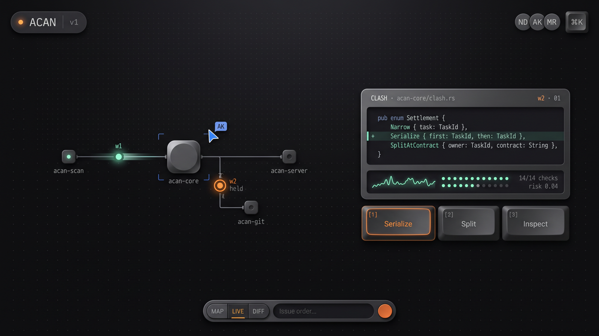
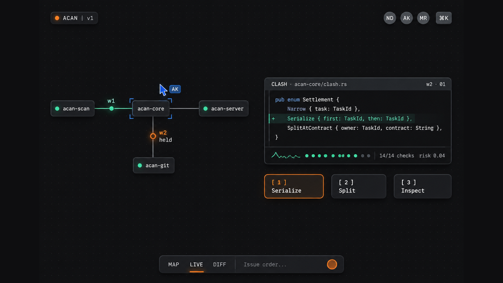

# Terminal-to-UI Mockups with GMI Cloud MCP

Sponsored by GMI Cloud.

I used GMI Cloud's MCP server from the terminal to iterate through four rounds of UI concepts for Acan, a desktop workspace for running coding agents side by side without putting a giant chat box in the middle. Rounds 1 to 3 produced classic boxed 3-pane SaaS layouts; Round 4 broke out onto a full-bleed dark spatial canvas inspired by tactile pocket-synth hardware. These are design mockups (the app does not have these screens yet).

Every paid call went through `estimate_generation` first and ran sequentially so no request was double-submitted.

## Selected hero outputs (Round 4)

### Selected hero: `gemini-nano-banana-2.1` (`2752 x 1536`, quoted `$0.0655` list)



Full-bleed dark dot-grid workbench, machined hardware nodes, live worker traces (`w1` and `w2`), multiplayer cursor (`AK`), clean 5-line Rust `Settlement` diff, miniature telemetry LEDs, and physical `1 / 2 / 3` keycaps (`outputs/v4-hero-nano-banana-2k-alt.png`).

### Runner-up: `gpt-image-2.6-sunburst-generate` (`1536 x 1024`, `quality: max`, quoted `$0.17257` list)



Cleanest minimal UI with spotless typography across the whole frame (`outputs/v4-hero-sunburst-max.png`).

## What is in this repo

- `prompts.md`: Round 1 prompts (three initial visual directions).
- `prompts-v2.md`: Round 2 prompts (light-mode board, map, and receipt suite).
- `prompts-v3-hero.md`: Round 3 dark warm-graphite hero prompt.
- `prompts-v4-hero.md`: Round 4 full-bleed tactile spatial workbench prompt.
- `outputs/`: All generated PNGs across Rounds 1 to 4 (plus `outputs/x-ready/` 1600x900 crops).
- `AGENTS-gmi-mcp-snippet.md`: Spend-guard and MCP workflow rules to paste into `AGENTS.md` or `CLAUDE.md`.
- `cost-log.md`: Every request ID, model, quoted list cost, status, and settled promo credit reconciliation.

## Setup

The MCP server endpoint is `https://mcp.gmicloud.ai/mcp`. Sign-in happens in the browser through OAuth, so no API key goes into a config file.

Droid (one command, verified against `droid mcp add --help`):

```bash
droid mcp add gmi https://mcp.gmicloud.ai/mcp --type http
```

Claude Code (from GMI's MCP docs at docs.gmicloud.ai):

```bash
claude mcp add --transport http gmi https://mcp.gmicloud.ai/mcp
```

Codex CLI (from GMI's MCP docs):

```bash
codex mcp add gmi --url https://mcp.gmicloud.ai/mcp
codex mcp login gmi
```

Cursor (add to `~/.cursor/mcp.json`, then connect in Cursor's MCP settings):

```json
{
  "mcpServers": {
    "gmicloud": {
      "url": "https://mcp.gmicloud.ai/mcp"
    }
  }
}
```

## Workflow: quote before you spend

1. `search_models` to discover current image models in the catalog.
2. `get_model` to inspect exact parameter names, types, and enum values. Do not guess them.
3. `estimate_generation` with the exact payload. Review the quote before approving.
4. `submit_generation` one job at a time. Wait for completion before starting the next job.

## Edit loop with upload_media

1. Call `upload_media` with the file type. It returns `upload_url`, `public_url`, and `content_type`.
2. PUT the image bytes to `upload_url` using the exact returned `content_type`.
3. Pass `public_url` inside `parameters` to `estimate_generation` and `submit_generation` on an edit model such as `gpt-image-2.6-sunburst-edit`.

## Real gotchas from this run

1. **Check input schemas with `get_model`:** `flux-kontext-pro` only accepts text input on GMI, so I swapped it out before spending anything.
2. **Parameter names vary by model:** GPT image models use `size` and `quality`; Gemini image models use `image_size`, `image_output_format`, and `thinking` (with `aspect_ratio` top-level).
3. **Run submits sequentially:** Firing concurrent `submit_generation` calls returned `submit_ambiguous`. Always check `list_generations` before retrying so you do not double-charge.
4. **`gemini-nano-banana-2.1` returns two images when `n=1`:** Item 0 is a `1376 x 768` draft and item 1 is the sharp `2752 x 1536` render. Download all returned media items, not just index 0. Settled promo credit drops in Rounds 3 (`-$0.25`) and 4 (`-$0.24`) matched single-image quotes, confirming it did not double-charge for the second item.
5. **Account credit settles asynchronously:** Re-read `get_account_summary` a couple minutes after a run finishes rather than right on completion.

## Cost summary (GMI only)

Quoted list price before any org discount, all runs dated 2026-11-20.

| Group | Generations | Quoted list cost (USD) |
|---|---|---|
| Round 1, successful | 3 | 0.43728 |
| Round 2, successful | 5 | 0.36545 |
| Edit pass 1 | 1 | 0.088343 |
| Round 3, successful (v3 dark hero) | 2 | 0.240045 |
| Round 4, successful (v4 spatial hero) | 2 | 0.23807 |
| **Successful total** | **13** | **1.369188** |
| Failed run (503 overload, quote only) | 1 | 0.20 |

Settled account balance: promo credit moved from **$49.58** to **$48.25** (**$1.33** actual settled drop across all 4 rounds; cash balance **$0.00**). Full request-by-request breakdown in `cost-log.md`.
